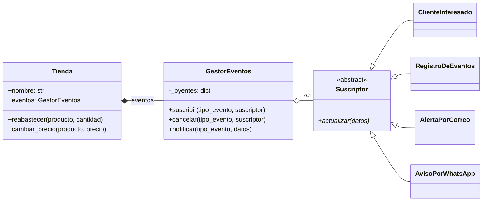

# Patrón Observer en Python: Tienda con avisos de disponibilidad

Implementación del patrón de diseño de comportamiento **Observer** para una tienda que avisa a sus clientes cuando un producto vuelve a estar disponible o cambia de precio.

Basada en la explicación de Refactoring Guru: https://refactoring.guru/es/design-patterns/observer

**Autora:** Sofía Santamaría Rendón · Universidad del Quindío

---

## ¿Qué problema resuelve?

Un cliente quiere saber cuándo llega un producto a la tienda. Hay dos malas soluciones:

- El cliente pregunta todos los días (pierde tiempo en consultas inútiles).
- La tienda avisa a todos los clientes (envía spam a quien no le interesa).

Con **Observer**, cada cliente se **suscribe** solo a los eventos que le interesan. La tienda avisa únicamente a esos suscriptores, que pueden darse de baja en cualquier momento.

## Roles del patrón en este proyecto

| Rol del patrón | Clase | Archivo |
|---|---|---|
| Interfaz suscriptora | `Suscriptor` (clase abstracta con `abc.ABC`) | `suscriptor.py` |
| Lista de suscripción | `GestorEventos` | `gestor_eventos.py` |
| Notificador | `Tienda` (usa composición: atributo `eventos`) | `tienda.py` |
| Suscriptores concretos | `ClienteInteresado`, `RegistroDeEventos`, `AlertaPorCorreo`, `AvisoPorWhatsApp` | un archivo por clase |
| Cliente (configura) | `main()` | `main.py` |

## Diagrama de clases




## Estructura

```
observer_tienda/
├── suscriptor.py            # Interfaz Suscriptor
├── gestor_eventos.py        # GestorEventos: suscribir, cancelar, notificar
├── tienda.py                # Notificador: Tienda
├── cliente_interesado.py    # Suscriptor concreto
├── registro_de_eventos.py   # Suscriptor concreto
├── alerta_por_correo.py     # Suscriptor concreto
├── aviso_por_whatsapp.py    # Suscriptor agregado sin modificar Tienda
├── main.py                  # Programa de demostración
├── test_observer.py         # Pruebas con unittest
```

## Requisitos

- Python **3.10** o superior.
- No usa librerías externas.

## Cómo ejecutar

Clona el repositorio y entra a la carpeta:

```bash
git clone <URL-del-repositorio>
cd <nombre-del-repositorio>
```

Ejecuta la demostración:

```bash
python3 main.py
```

Ejecuta las pruebas:

```bash
python3 -m unittest -v
```

> En Windows usa `python` o `py` en lugar de `python3`.

## Eventos disponibles

| Evento | Se dispara desde | Datos que recibe el suscriptor |
|---|---|---|
| `producto_disponible` | `Tienda.reabastecer()`, solo si el producto estaba agotado | `tienda`, `producto`, `cantidad` |
| `precio_cambiado` | `Tienda.cambiar_precio()` | `tienda`, `producto`, `precio_anterior`, `precio_nuevo` |

## Ejemplo de uso

```python
from cliente_interesado import ClienteInteresado
from tienda import PRODUCTO_DISPONIBLE, Tienda

tienda = Tienda("TecnoQuindío")
ana = ClienteInteresado("Ana")

tienda.eventos.suscribir(PRODUCTO_DISPONIBLE, ana)  # Ana se suscribe
tienda.reabastecer("iPhone 17", 5)                    # Ana recibe el aviso

tienda.eventos.cancelar(PRODUCTO_DISPONIBLE, ana)    # Ana se da de baja
tienda.reabastecer("AirPods", 10)                     # Ana ya no recibe nada
```

## Qué demuestra `main.py`

1. **Filtrado por evento:** Ana solo está suscrita a `producto_disponible`, así que no recibe el aviso de cambio de precio.
2. **Baja en tiempo de ejecución:** Ana cancela su suscripción a mitad de la ejecución y deja de recibir avisos, sin que se modifique `Tienda`.
3. **Suscriptor como función:** una `lambda` funciona como suscriptor, sin necesidad de crear una clase.
4. **Principio abierto/cerrado:** `AvisoPorWhatsApp` se agregó después, sin modificar `Tienda`, `GestorEventos` ni los otros suscriptores.

## Pruebas

| Prueba | Qué verifica |
|---|---|
| `test_recibe_evento_suscrito` | Un suscriptor recibe el evento al que se suscribió |
| `test_no_recibe_eventos_de_otro_tipo` | Un suscriptor no recibe eventos de otro tipo |
| `test_no_recibe_tras_cancelar` | Tras cancelar la suscripción, no recibe más avisos |
| `test_todos_los_suscriptores_son_notificados` | Con varios suscriptores, todos son notificados |
| `test_suscriptor_funcional_lambda` | Una función también puede ser suscriptora |
| `test_nuevo_suscriptor_sin_modificar_tienda` | Se puede agregar un suscriptor nuevo sin tocar `Tienda` |
| `test_no_duplica_suscripciones` | Suscribir dos veces no duplica los avisos |
| `test_reabastecer_con_stock_no_notifica` | Si el producto ya tenía stock, no se envía aviso |

Resultado esperado:

```
Ran 8 tests in 0.001s

OK
```

## Cómo agregar un nuevo suscriptor

1. Crea un archivo nuevo con una clase que herede de `Suscriptor`.
2. Implementa el método `actualizar(self, datos)`.
3. Regístrala en `main.py` con `tienda.eventos.suscribir("nombre_evento", tu_suscriptor)`.

No hace falta modificar `Tienda` ni `GestorEventos`.

## Referencia

- Refactoring Guru. *Observer*. https://refactoring.guru/es/design-patterns/observer
